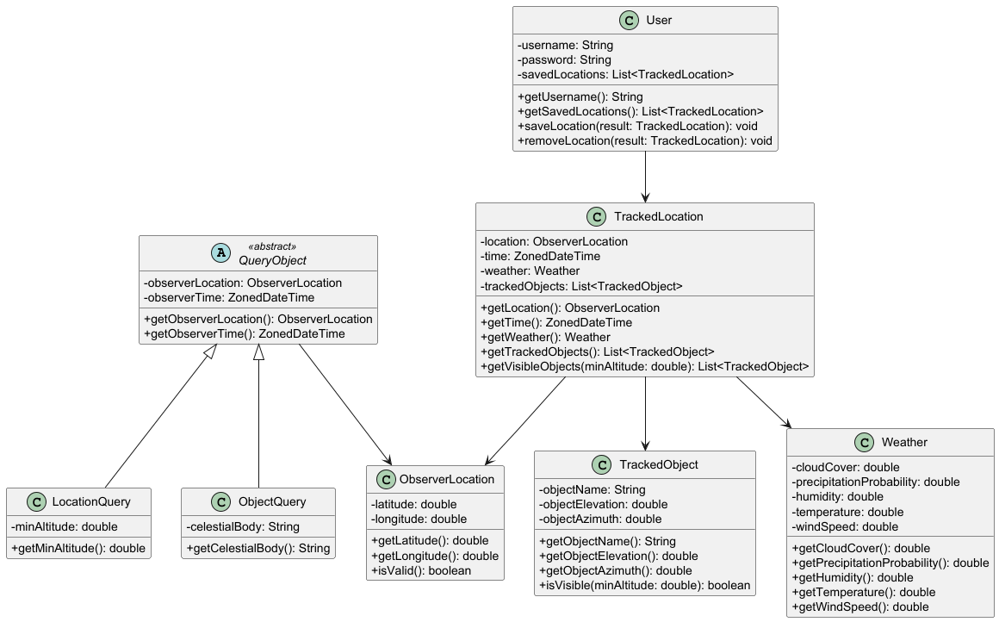

# Astronomy Tracking App

## Team Information

### Team Members
- James Fu
- Laien Zou
- Austin Zhang
- Sachkeerat Chhina

---

## Project Description

### Astronomy

Hobbyist star trackers face two primary challenges:
1. The existence of the earth’s curvature means that the visibility and location of certain celestial objects require tools to predict.
2. Weather conditions heavily impact the ability of precision tools to get a clean picture of these objects.

   As such, this app seeks to accomplish two primary tasks:

-  Allow hobbyists to see which celestial objects will be visible from which parts of a planet from certain points in time.

-  Allow hobbyists to see weather forecasts and historical climate data at those locations at those times in order to make informed decisions as to whether they are likely able to get a clean picture.

---

## User Stories

- As a casual stargazer, I want to know which celestial bodies will be visible from a specific location at a given time.

- As a prepared astrophotographer, I want to know whether a certain celestial body will be visible at a location at time and save it.

- As an astrophotographer I want to be able to know which bodies will be bright enough for me to see during my session.

- As an inexperienced stargazer, I want to know where to look into the sky to see a certain celestial object.

- As a beginner astronomer, I want to learn basic information about the celestial objects I find so that I can better understand what I am observing.

---

## Use Cases

### Use Case 1
#### User Sign-up
1. The user enters a username
2. The user enters a password twice
3. If the username exists, the system alerts the user
4. If the password does not match, the system alerts the user
5. If the username does not exist and the password matches, the system creates the user but does not log them in.

### Use Case 2
#### User Logs in
1. The user enters a username and password
2. If the username exists in the system and the passwords match, then the system shows that the user is logged in
3. If there is no such username, the system alerts the user
4. If the password doesn’t match the one in the system, the system alerts the user

### Use Case 3
#### User Logs out
1. The user logs out through UI
2. The system shows the user is logged out

### Use Case 4
#### User wants the best time of a selected celestial object for a given location
1. The user inputs the name of the celestial object they want to observe and specifies a time range and location.
2. If the celestial object is not recognized or supported, the system alerts the user.
3. Otherwise, the system retrieves necessary astronomical information about selected object.
4. The system determines the times within the specified search criteria where the object meets the visibility requirements.
5. If no suitable viewing opportunities are found, the system informs the user.
6. Otherwise, the system displays the suggested viewing times.

### Use Case 5
#### User wants celestial objects with the given location and time
1. The user inputs the location and time at which they want to observe celestial objects.
2. If the location or time is invalid, the system alerts the user.
3. Otherwise, the system determines the positions of supported celestial objects relative to the user's location at the specified time.
4. The system identifies which celestial objects meet the visibility requirements.
5. If no celestial objects meet the requirements, the system informs the user that none were found.
6. Otherwise, the system displays a list of visible celestial objects.

### Use Case 6
#### User interacts with list of objects that they saved
1. The logged-in user chooses to view their saved queries through the UI.
2. The system retrieves the saved queries associated with the user's account.
3. If the user has no saved queries, the system informs the user that their saved queries list is empty.
4. Otherwise, the system displays the user's saved queries.
5. The user selects a saved query from the list.
6. The system displays the information associated with the selected query.

---

## Minimal Viable Product (MVP)

| Team Member | MVP Use Case |
|-------------|--------------|
| James Fu | Use Case |
| Laien Zou | Use Case |
| Austin Zhang | Use Case |
| Sachkeerat Chhina | Use Case |

---

## Entities

### QueryObject (abstract)
Stores what the user asks for: where and when they want to observe.
- `observerLocation: ObserverLocation`: where the user wants to observe
- `observerTime: ZonedDateTime`: when the user wants to observe, including the time zone

### LocationQuery extends QueryObject
"What can I see from this location at this time?"
- `minAltitude: double`: only objects at least this many degrees above the horizon are shown

### ObjectQuery extends QueryObject
"Where is this object from this location at this time?"
- `celestialBody: String`: name of the celestial object to track

### ObserverLocation
A place on Earth where the user observes from.
- `latitude: double`: in degrees, from -90 to 90 (north is positive)
- `longitude: double`: in degrees, from -180 to 180 (east is positive)

**Methods:**
- `isValid(): boolean`: returns true if latitude is in [-90, 90] and longitude is in [-180, 180]

### TrackedLocation
The result of a query: all tracked objects for one location and time, plus the weather there.
For an `ObjectQuery`, the list contains a single object.
- `location: ObserverLocation`: the observer's location
- `time: ZonedDateTime`: the time this result was calculated for
- `weather: Weather`: the weather at that location and time
- `trackedObjects: List<TrackedObject>`: the objects calculated for this location

**Methods:**
- `getVisibleObjects(minAltitude: double): List<TrackedObject>`: returns only the objects at least `minAltitude` degrees above the horizon

### TrackedObject
The calculated position of one celestial object at a given time and location.
- `objectName: String`: name of the object
- `objectElevation: double`: angle above the horizon, in degrees (negative = below the horizon)
- `objectAzimuth: double`: compass direction, in degrees (0° = North, 90° = East)

**Methods:**
- `isVisible(minAltitude: double): boolean`: returns true if `objectElevation` is at least `minAltitude`

### Weather
The weather at one location and time, from the Open-Meteo Forecast API.
- `cloudCover: double`: total cloud cover, in %; the most important factor for astrophotography
- `precipitationProbability: double`: chance of rain or snow, in %
- `humidity: double`: relative humidity, in %; high humidity can fog up lenses
- `temperature: double`: in °C
- `windSpeed: double`: in km/h; strong wind shakes the telescope

### User
A registered user and the results they have saved.
- `username: String`
- `password: String`
- `savedLocations: List<TrackedLocation>`: results this user has saved

**Methods:**
- `saveLocation(result: TrackedLocation): void`: adds a result to the saved list
- `removeLocation(result: TrackedLocation): void`: removes a result from the saved list

---

## API Usage

### NASA JPL Horizons API

**Documentation:** https://ssd-api.jpl.nasa.gov/doc/horizons.html

**How it is used in the program:**
- Gets the position (elevation and azimuth) of solar system objects — planets, the Sun and the Moon — as seen from the user's location at a given time.
- Stars are not covered by Horizons; their positions are computed locally from catalog RA/Dec values.
- No API key is required. The response is JSON, with the ephemeris table as text between `$$SOE` and `$$EOE` markers, which we parse.

### Open-Meteo Weather Forecast API

**Documentation:** https://open-meteo.com/en/docs

**How it is used in the program:**
- Gets the hourly forecast (cloud cover, precipitation probability, humidity, temperature, wind speed) for the user's location and viewing time, up to 16 days ahead.
- Used to judge whether conditions are good enough for astrophotography.
- No API key is required for non-commercial use.

---

## Design Diagrams

### UML Class Diagram

### Sequence Diagrams

---

## How to Run

[Instructions for running the program.]

---

## Notes

[Any additional project information.]
